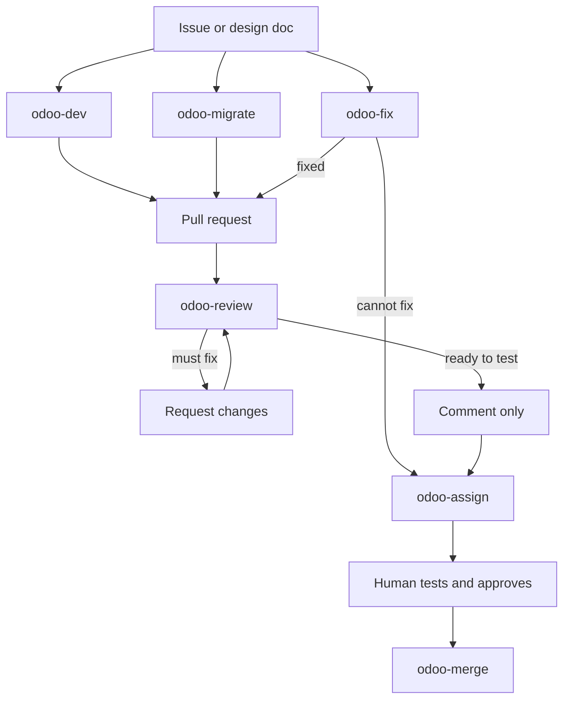

# OCA Cursor Agent Skills

Shared [Cursor Agent Skills](https://cursor.com/docs/skills) for OCA module delivery.

## Architecture

```
ai-skills/
├── shared/                 # Platform policy (imported by workflow skills)
├── odoo-dev/               # New addon from a GitHub issue or design doc
├── odoo-migrate/           # Port module to a new Odoo series
├── odoo-fix/               # Bug fix from a GitHub issue
├── odoo-assign/            # Assign an issue or PR to the module maintainer or PSC
├── odoo-review/            # Review an OCA PR (relevance, gates, CI, Bugbot/security/perf)
├── odoo-merge/             # Merge a PR when gates pass (ocabot or GitHub API)
├── odoo-rebase/            # Rebase a PR head on your fork
└── odoo-translate/         # Weblate + i18n/ (.pot / .po) for OCA modules
```

**Workflow skills are thin** — steps + links. **Policy lives once** under `shared/`.

### Which skill?

| Need | Skill |
|------|--------|
| New module from a GitHub issue or design doc | `odoo-dev` |
| Port existing module to N.0 | `odoo-migrate` |
| Bug / CI / traceback from a GitHub issue | `odoo-fix` |
| Assign an issue or PR (module maintainer, else least-loaded PSC) | `odoo-assign` |
| Review an OCA module PR | `odoo-review` |
| Merge a PR (gates + ocabot / API) | `odoo-merge` |
| Rebase a PR head on your fork | `odoo-rebase` |
| Translate module (Weblate / i18n) | `odoo-translate` |

### Process

An issue becomes a pull request, or it is assigned when it cannot be fixed. A pull request is reviewed, then assigned for a person to test. No skill approves. A human approves after testing, and `odoo-merge` runs only when the merge gates already pass.

`odoo-assign` picks the module maintainer with the fewest open assignments in that repository. If the module has no maintainer, it picks the Project Steering Committee member with the fewest. If the issue or pull request has no milestone and no labels, it sets the series milestone and the `needs review`, `series:`, and `mod:` labels first.

`odoo-rebase` updates a pull request onto its base branch. `odoo-translate` updates `i18n/` and does not assign or approve.



### Shared platform

| File | Purpose |
|------|---------|
| [shared/validation-gate.md](shared/validation-gate.md) | pre-commit + tests + coverage >99% before commit/push |
| [shared/git-commit.md](shared/git-commit.md) | Never `Co-authored-by: Cursor` — use `Assisted-by` |
| [shared/git-one-module.md](shared/git-one-module.md) | One addon per branch/PR |
| [shared/contributor.md](shared/contributor.md) | Fork owner, copyright, maintainer — set once |
| [shared/fork-remote.md](shared/fork-remote.md) | Push to your fork, never OCA |
| [shared/oca-pr.md](shared/oca-pr.md) | Labels, milestone, reviewer, PR body (USAGE/test path + deps), triage, request changes, ocabot, CI loop |
| [shared/oca-conventions.md](shared/oca-conventions.md) | Manifest keys, copyright, readme, icon, headers, demo, i18n |
| [shared/oca-merge-policy.md](shared/oca-merge-policy.md) | 5 days / 2 reviews (or no-review fallback) |
| [shared/testing.md](shared/testing.md) | Discover/run tests + coverage |

## Install

```bash
git clone https://github.com/ursais/ai-skills.git /tmp/ai-skills
mkdir -p ~/.cursor/skills
cp -r /tmp/ai-skills/shared ~/.cursor/skills/
cp -r /tmp/ai-skills/odoo-migrate ~/.cursor/skills/
cp -r /tmp/ai-skills/odoo-dev ~/.cursor/skills/
cp -r /tmp/ai-skills/odoo-fix ~/.cursor/skills/
cp -r /tmp/ai-skills/odoo-assign ~/.cursor/skills/
cp -r /tmp/ai-skills/odoo-review ~/.cursor/skills/
cp -r /tmp/ai-skills/odoo-merge ~/.cursor/skills/
cp -r /tmp/ai-skills/odoo-rebase ~/.cursor/skills/
cp -r /tmp/ai-skills/odoo-translate ~/.cursor/skills/
```

Edit `~/.cursor/skills/shared/contributor.md` once. Set `fork_owner`, `author_name`, `author_url`, and `author_email`. Leave `maintainer` blank to use the logged-in GitHub user. Assignees are chosen by `/odoo-assign`, not by this file.

Reload Cursor. Invoke with `/odoo-migrate`, `/odoo-dev`, `/odoo-fix`, `/odoo-assign`, `/odoo-review`, `/odoo-merge`, `/odoo-rebase`, or `/odoo-translate`.

**`shared/` must sit next to the skills** (`~/.cursor/skills/shared`) so relative links like `../shared/validation-gate.md` resolve. Re-copying `shared/` overwrites `contributor.md` — keep a copy of your filled-in file and put it back.

## Prerequisites

```bash
export GITHUB_TOKEN=ghp_xxx   # repo scope
# git, gh, pre-commit, gettext (msgmerge), coverage (pip install coverage)
# Odoo or docker test harness for write skills
```

## Updating

Edit under the skill or `shared/`, then:

```bash
git add -A && git commit -m "$(cat <<'EOF'
Update skills

Assisted-by: Cursor <cursoragent@cursor.com>
EOF
)" && git push
```

Never use `Co-authored-by: Cursor` — see [shared/git-commit.md](shared/git-commit.md).

Teammates re-copy from this repo into `~/.cursor/skills/`.

## Contributing

Open a PR on this repo before changing shared workflows.
Keep `SKILL.md` under ~250 lines; put detail in `shared/` or skill `references/`.
